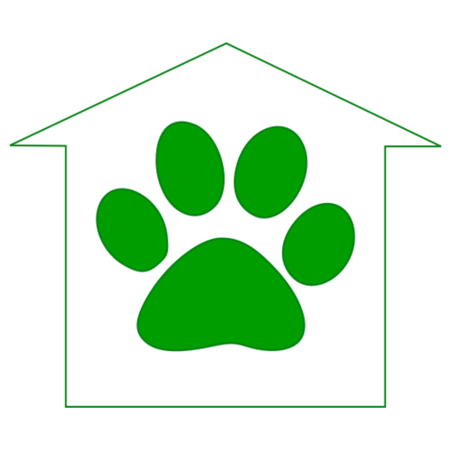

Animal Shelter Manager (ASM3) permite gestionar animales, adopciones, acogidas,
atención veterinaria, personas, voluntariado, donaciones, documentos, informes y
formularios en línea.

Este paquete integra la aplicación Python oficial con Nginx, systemd y MariaDB de
YunoHost. Crea el administrador, instala plantillas e informes, programa las tareas
diarias y ofrece actualización, copia de seguridad, restauración, cambio de URL y
varias instancias independientes.

El portal de YunoHost y LDAP permiten crear perfiles del personal. Los accesos
privados requieren un segundo factor TOTP. Dex y OpenID Connect son opcionales.
